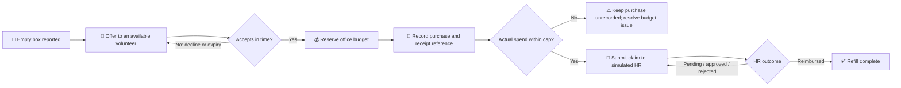

# 🥨 Snack Counter Automation

**An empty box should never be a mystery.** This Java 17 prototype turns a snack refill into a visible, budget-aware journey—from the first “we’re out” report to a clearly tracked reimbursement outcome.

[](https://www.oracle.com/java/technologies/javase/jdk17-archive-downloads.html)
[](https://maven.apache.org/)
[](https://junit.org/junit5/)


> **The idea:** make ownership, spending, and reimbursement easy to follow without building a production platform before the core workflow is proven.

## The journey



<details>
<summary><strong>What happens at each step?</strong></summary>

1. **Report:** one active refill is opened for the office and snack box.
2. **Assign:** available volunteers receive offers in per-office rotation by employee ID. Declines and expiries hand the offer on; if nobody is eligible, the refill remains open for retry.
3. **Protect the budget:** acceptance reserves the expected cost. The actual purchase is charged to its purchase month only if that office’s cap still allows it.
4. **Follow the claim:** simulated HR tracks pending, approved, rejected, and reimbursed states. Approval is not payment; the refill is complete only when reimbursement is reported.

</details>

## Two offices, two budgets

| Office | Monthly limit | Currency | Reporting |
| --- | ---: | :---: | --- |
| Oslo | 6,000 | NOK | Local total; optional combined NOK report |
| Bengaluru | 15,000 | INR | Local total; converted only with an explicit INR-to-NOK rate |

No exchange rate is guessed or silently applied.

## Try it

Requires Java 17+ and Maven 3.8+.

```sh
mvn test
```

The tests are the runnable demonstration: they cover the refill lifecycle, assignment handoff, budget limits, purchase recording, HR claims, and reimbursement. **There is no standalone command-line app yet.**

## What’s inside

- **Refill coordination:** offers, acceptance, deadlines, and handoffs.
- **Budget service:** reservations, actual purchases, and monthly reports.
- **Simulated chat and HR:** local, testable gateways; no external messages or claims are sent.
- **Automated tests:** domain rules through end-to-end service workflows.
- **[Design note](docs/design.md):** the decisions, boundaries, and deliberate exclusions.

<details>
<summary><strong>Prototype boundaries and known trade-offs</strong></summary>

- State is in memory and resets on restart; synchronization covers only one process.
- Expiry is caller-triggered—there is no background scheduler. If a volunteer buys snacks after reassignment, follow-up is manual.
- Chat, HR, and employee identity are not connected to real systems. Login, inbound chat commands, calendars, and holiday handling are not implemented.
- A receipt is represented by a reference, not stored image data. Purchase descriptions are recorded, but actual snack consumption is not measured.
- HR timing/escalation and payroll-currency conversion are outside this prototype. Rotation balances **offers**, not completed purchases.

</details>

## Repository map

| Path | Purpose |
| --- | --- |
| `src/main/java` | Domain model and workflow services |
| `src/test/java` | Automated tests |
| [`docs/design.md`](docs/design.md) | Reviewer-facing design and trade-offs |
| `pom.xml` | Java and test build configuration |
